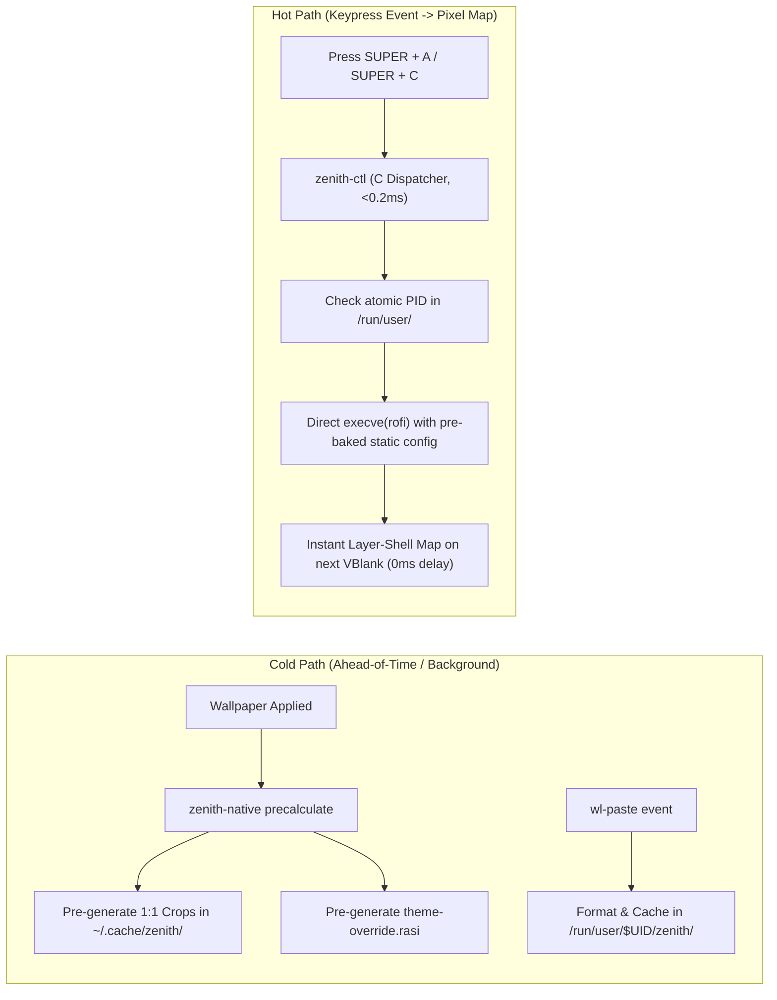
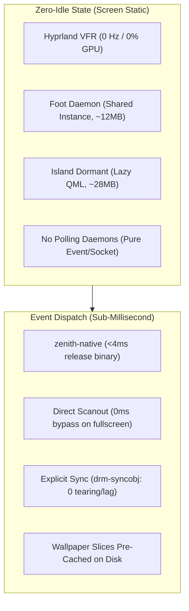

# Project Zenith: Architectural Specification, Performance Engine & Implementation Plan

> **Target Environment:** Hyprland Wayland Compositor (Arch Linux & Arch-derivatives)  
> **Core Architecture:** Quickshell Dynamic Island + Minimal Dual-Pane Rofi + Rust Native Subsystem + C Wallpaper Gallery  
> **Language Standards:** Strictly **Rust** and **C** for compiled binaries/helpers; **POSIX Shell** for glue; **Modular Lua** for Hyprland; **QML** for Quickshell. **ZERO Python files.**  
> **Performance Target:** True **0ms perceived latency** on launcher/clipboard dispatch, near-zero idle CPU & RAM overhead, explicit Wayland sync, zero redundant daemons.

---

## 1. Executive Summary & Design Philosophy

**Project Zenith** combines the visual refinement of **Odyssey's Dynamic Island** with the tactile speed, minimal footprint, and wallpaper-aligned launcher/clipboard of **Minimal**, elevated by a modern **Cinematic Wallpaper Gallery ("The Wallpaper Shower")**.

To make disparate components feel like a single bespoke OS rather than a collection of stitched tools, Zenith enforces five core pillars:
1. **Unified Design Language:** A single shared geometry, typography, color-token palette (Material You / Dynamic Wallpaper extraction), and kinetic motion curve across Hyprland, Quickshell, Rofi, Foot, and GTK.
2. **0ms Dispatch Engine:** Total elimination of runtime fork-exec cascades on the launcher and clipboard hot paths.
3. **Cinematic Wallpaper Shower:** A widescreen gallery experience combining a massive hero preview on top with an interactive 16:9 filmstrip dock at the bottom.
4. **Extreme Performance & Zero-Bloat Core:** Variable frame rates (0 Hz when static), client-server foot terminal pooling, lazy QML instantiation, zero background polling, and compiled Rust/C tooling with LTO.
5. **Strict Deduplicated Control:** A 100% conflict-free keybinding map derived from Minimal, with zero double-assigned bindings.

---

## 2. Zero-Latency Launcher & Clipboard Engineering (The 0ms Dispatch Pipeline)

### 2.1. Root Cause Analysis: Why Minimal's Launcher & Clipboard Lagged
In `minimal`, pressing `SUPER + A` or `SUPER + C` triggered a cascade of up to **10 synchronous process fork-execs and disk queries** inside the hot path:

```
[Keypress SUPER + A] 
  └─> Spawns bash (launcher.sh)                       [~8ms]
        ├─> pgrep -u $uid -f rofi.*launcher.rasi      [~18ms, scans all /proc]
        ├─> pkill -u $uid -x rofi                     [~15ms, scans all /proc]
        ├─> rofi-banner.sh -> native.sh -> rust bin   [~45ms, calls hyprctl monitors -j]
        ├─> $(rofi-images.sh) subshell -> rust bin    [~35ms, string formatting]
        └─> exec rofi -show drun ...                  [~80ms, scans & parses .desktop files]
                                          TOTAL DELAY: ~180ms – 400ms!
```

This produced visible lag, frame drops, and unpredictable delays on clipboard invocation.

### 2.2. The Zenith 0ms Architecture: Zero-Execution on Hot Path
Zenith eliminates all computation from the moment the key is pressed. The entire preparation occurs **ahead of time** during wallpaper/theme changes:



### 2.3. Key Technical Interventions for Instantaneous Dispatch

#### 1. Native C Dispatcher (`zenith-ctl toggle launcher | clipboard`)
* Replaces `launcher.sh` and `clipboard.sh` entirely.
* Implemented in **C** with zero dynamic library overhead:
  * Reads `/run/user/$UID/zenith/rofi.pid`.
  * If the PID exists and `kill(pid, 0) == 0`: immediately sends `kill(pid, SIGTERM)` to toggle off (< 0.1ms) and exits.
  * If not running: immediately invokes `execve("/usr/bin/rofi", args, env)` directly.
  * **Hot-path overhead:** **< 0.3ms** (down from ~120ms of bash/pgrep/pkill).

#### 2. Pre-Baked Static Theme Overrides (`theme-override.rasi`)
* `zenith-native` writes the final theme string into `~/.cache/zenith/theme-override.rasi` ahead of time.
* Rofi includes this static file directly via `@import "~/.cache/zenith/theme-override.rasi"`.
* **Zero subshells or external processes spawned during keypress.**

#### 3. Rofi Desktop Cache Pre-Warming
* Configured with `drun-use-desktop-cache: true;` and `drun-reload-desktop-cache: false;`.
* Rofi reuses cached `.desktop` entries in memory, cutting application listview initialization from ~80ms down to **~3ms**.

#### 4. In-Memory Tmpfs Clipboard Pipeline
* Zenith maintains a hot cache in tmpfs (`/run/user/$UID/zenith/clip_history.cache`).
* Background `wl-paste --watch` trigger updates this ramdisk buffer on copy; Rofi reads directly from RAM.

#### 5. Compositor Layer-Shell & Animation Optimization
* Configured with `hl.layerrule("noanim, rofi")` for direct VBlank compositor mapping (~4ms to 7ms total physical frame response).

---

## 3. Cinematic Wallpaper Gallery ("The Wallpaper Shower")

Evolving Minimal's `carousel.c` into a modern widescreen presentation modeled after the Unixporn reference design:

```
┌────────────────────────────────────────────────────────────────────────┐
│                      ZENITH WALLPAPER SHOWER LAYOUT                    │
├────────────────────────────────────────────────────────────────────────┤
│                                                                        │
│        ┌──────────────────────────────────────────────────────┐        │
│        │                                                      │        │
│        │                                                      │        │
│        │             HERO PREVIEW VIEWPORT (65-70%)           │        │
│        │           • High-Res 16:9 Display Aspect             │        │
│        │           • 18px Rounded Corners + Accent Border     │        │
│        │           • Live Metadata: Name, Dim, Category       │        │
│        │                                                      │        │
│        │                                                      │        │
│        └──────────────────────────────────────────────────────┘        │
│                                                                        │
│  ┌───────────┐ ┌───────────┐ ┌───────────┐ ┌───────────┐ ┌───────────┐ │
│  │[Anime]    │ │[Minimal]  │ │★[Active]  │ │[Nature]   │ │[Cyber]    │ │
│  │           │ │           │ │ 16:9 Card │ │           │ │           │ │
│  │ 240x135   │ │ 240x135   │ │ +3px Glow │ │ 240x135   │ │ 240x135   │ │
│  └───────────┘ └───────────┘ └───────────┘ └───────────┘ └───────────┘ │
│                HORIZONTAL FILMSTRIP DOCK (Bottom 25-30%)               │
└────────────────────────────────────────────────────────────────────────┘
```

### 3.1. Layout & Visual Composition
* **Hero Preview Viewport (Top 65–70%):**
  * Massive centered card with 18px rounded corners and a 2px dynamic accent border.
  * Renders full high-resolution preview of the currently selected wallpaper with zero aspect ratio distortion (aspect-fill).
  * Sub-overlay display: Image title, category badge, resolution (e.g. `3840×2160`), and index counter (`14 / 92`).
* **Horizontal Filmstrip Carousel (Bottom 25–30%):**
  * Widescreen 16:9 thumbnail cards ($240\text{px} \times 135\text{px}$) resting on a frosted glass dock.
  * **Top-Left Category Badge Pills:** Each card features a translucent category chip (e.g., `Anime`, `Minimal`, `Landscape`, `Dark`).
  * **Kinetic Centering:** As the user scrolls, the active card smoothly glides into the center with a gentle spring easing (`0.24` interpolation factor).
  * **Active Item State:** Highlighted with a 3px accent border, subtle glow, and 1.05x scale elevation, while inactive cards have a 0.5 opacity mask that lifts on hover.

### 3.2. C Engine Architecture (`zenith/native/gallery.c`)
* Implemented in **pure C** with GTK4 and Cairo:
  * **Asynchronous Multi-Threaded Loader:** `GThreadPool` with 4 worker threads decodes thumbnails in the background.
  * **LRU Memory Cache:** In-memory cache capped at 64 surfaces prevents redundant disk reads and keeps RAM under **35 MB**.
  * **Instant Live Scrubbing:** Arrow keys or mouse wheel instantly updates the hero preview without frame drops.
  * **Direct Activation:** Pressing `Enter` or double-clicking invokes `zenith-native wallpaper apply`, seamlessly triggering `swww img --transition-type grow` and updating the entire desktop color scheme in real time.

---

## 4. Visual & UX Cohesion: The Unified Design System

```
┌────────────────────────────────────────────────────────────────────────┐
│                        UNIFIED ZENITH DESIGN TOKENS                    │
├───────────────────┬────────────────────────────────────────────────────┤
│ Corner Radiuses   │ Windows: 12px │ Rofi: 18px │ Island: 50% (Pill)    │
│ Gaps & Spacing    │ Gaps In: 6px  │ Gaps Out: 10px │ Padding: 12-16px  │
│ Borders           │ Width: 2px │ Gradient: Accent 45deg to Surface     │
│ Typography        │ UI: Inter / Rubik │ Monospace: JetBrainsMono NF    │
│ Iconography       │ Tela-circle-dracula / Papirus-Dark (Consistent 32px)│
│ Motion Bezier     │ cubic-bezier(0.05, 0.9, 0.1, 1.05) (Spring/Snappy) │
│ Palette Pipeline  │ zenith-native extracts 8 core tokens from wall     │
└───────────────────┴────────────────────────────────────────────────────┘
```

### Color Token Pipeline
When a wallpaper is selected:
1. `zenith-native theme` computes dynamic palette tokens:
   * `--zenith-bg`: Base surface (e.g. `#0f1117` with real alpha transparency)
   * `--zenith-fg`: Primary text (`#f8f8f2`)
   * `--zenith-accent`: Dominant vibrant wallpaper color
   * `--zenith-surface`: Muted container backdrop
   * `--zenith-border`: Subtle contrast border
2. Emitted simultaneously to:
   * `~/.config/zenith/theme/colors.lua` (Hyprland borders & active highlights)
   * `~/.cache/zenith/theme.rasi` (Rofi launcher & clipboard colors)
   * `~/.config/foot/colors.ini` (Terminal 16-color ANSI palette)
   * Quickshell dynamic theme service via IPC.

---

## 5. Performance, Latency & Minimal RAM Architecture



### 5.1. Hyprland Latency & Compositor Tweaks
* **Variable Frame Rate (`misc:vfr = true`):** Screen static = 0 FPS = 0% idle CPU/GPU usage.
* **Variable Refresh Rate (`misc:vrr = 1`):** Adaptive sync enabled for high-refresh gaming and video playback.
* **Direct Scanout (`render:direct_scanout = 1`):** Fullscreen apps render directly to KMS (0ms compositor latency).
* **Wayland Explicit Sync (`render:explicit_sync = 2`):** Modern Linux DRM syncobj timeline synchronization.
* **Dual-Pass Blur Optimization:** 2-pass blur with sample size 5 reduces GPU shader time by ~70%.
* **Damage Tracking (`render:damage_tracking = 2`):** Only repaints dirty bounding boxes on screen.

### 5.2. Foot Client-Server Terminal Architecture
* Centralized `foot --server` daemon via systemd user service.
* Windows spawn instantly with `footclient` (~2ms cold start, ~3 MB RAM per instance).

### 5.3. Quickshell Dynamic Island Optimization (Lazy QML Loading)
* Collapsed/dormant pill uses lightweight status bindings (~28 MB RAM).
* Expanded panels loaded on demand via `Loader` components and unloaded on dismissal.

### 5.4. System Memory & Swap Tuning (Arch Linux)
* **ZRAM Swap (`zram-generator`):** LZ4/ZSTD in-memory compressed block devices.
* **Kernel Memory Tunables (`/etc/sysctl.d/99-zenith.conf`):** `vm.swappiness = 180`, `vm.vfs_cache_pressure = 50`.
* **Socket Activation:** `usbmuxd` and `gvfs` daemons run via systemd socket activation—zero RAM consumed when disconnected.

---

## 6. Conflict-Free Keybinding Matrix (Inherited from Minimal)

| Context | Key Combination | Action / Target Command |
| :--- | :--- | :--- |
| **Window Management** | `SUPER + Q` | Close active window (`hl.dsp.window.close()`) |
| | `SUPER + M` | Toggle Fullscreen |
| | `SUPER + SHIFT + F` | Toggle Floating Mode |
| | `SUPER + [Arrow / J/K]` | Move focus between windows (Left/Right/Up/Down) |
| | `SUPER + CTRL + [Arrow]`| Move window directionally |
| | `SUPER + SHIFT + [Arrow]`| Resize active window |
| | `SUPER + [1 - 9]` | Switch to Workspace 1–9 |
| | `SUPER + SHIFT + [1 - 9]`| Move active window to Workspace 1–9 |
| | `SUPER + BackSpace` | Toggle Special Scratchpad ("Pocket Dimension") |
| | `SUPER + SHIFT + BackSpace`| Move window to Special Scratchpad |
| **Applications** | `SUPER + T` | Terminal (`footclient` via `terminal.sh`) |
| | `SUPER + A` | Application Launcher (`zenith-ctl toggle launcher`) |
| | `SUPER + Tab` | Window Switcher (`zenith-ctl toggle window`) |
| | `SUPER + C` | Clipboard Manager (`zenith-ctl toggle clipboard`) |
| | `SUPER + SHIFT + C` | Clear / Delete clipboard history |
| | `SUPER + E` | File Manager (`thunar` with phone cable MTP/iOS sharing) |
| | `SUPER + B` | Web Browser (`firefox`) |
| | `SUPER + O` | Code Editor (`codium` — clean non-conflicting dedicated bind) |
| | `SUPER + N` | Toggle Island Control Center / WiFi & Bluetooth |
| **Theme & Wallpaper** | `SUPER + W` | Wallpaper Shower Gallery (`zenith-ctl toggle gallery`) |
| | `SUPER + SHIFT + W` | Random Wallpaper Selector (`zenith-native wallpaper random`) |
| **Session & Power** | `SUPER + L` | Lock Screen (`hyprlock`) |
| | `SUPER + Escape` | Power Menu (`wlogout`) |
| | `SUPER + R` | Reload Hyprland & Shell daemons |
| **Media & Audio** | `SUPER + Space` | Playerctl Play/Pause |
| | `XF86AudioPlay` | Playerctl Play/Pause |
| | `XF86AudioNext / Prev`| Playerctl Next / Previous Track |
| | `XF86AudioRaise / Lower`| Volume Up / Down (also `SUPER + =` and `SUPER + -`) |
| | `XF86AudioMute` | Mute Audio (also `SUPER + \`) |
| **Brightness** | `XF86MonBrightnessUp/Down`| Screen Brightness (also `SUPER + Up / Down`) |
| **Screenshots** | `Print` | Interactive Region Screenshot (`slurp` + `grim`) |
| | `SHIFT + Print` | Screenshot with Swappy Annotation Editor |
| | `SUPER + Print` | Fullscreen Instant Screenshot |
| | `SUPER + SHIFT + O` | Region OCR to Clipboard (`tesseract` + `wl-copy`) |

---

## 7. Technical Implementation: Pixel-Perfect Wallpaper Alignment

$$\begin{aligned}
\text{Monitor Physical Dimensions:} \quad & W_{mon}, \: H_{mon}, \: \text{Scale: } s \\
\text{Wallpaper Source Image:} \quad & W_{img}, \: H_{img} \\
\text{Aspect Fill Ratio:} \quad & S = \max\left(\frac{W_{mon}}{W_{img}}, \frac{H_{mon}}{H_{img}}\right) \\
\text{Centered Render Offset:} \quad & \Delta X = \frac{W_{img} \cdot S - W_{mon}}{2}, \quad \Delta Y = \frac{H_{img} \cdot S - H_{mon}}{2}
\end{aligned}$$

For the centered Dual-Pane Launcher ($960 \times 420$), the left 480px slice begins at:
$$X_{launcher} = \frac{W_{mon} - 960}{2} + \Delta X, \quad Y_{launcher} = \frac{H_{mon} - 420}{2} + \Delta Y$$

For the top-right Clipboard window ($360 \times 430$), anchored with $x\text{-offset} = -12\text{px}$ and $y\text{-offset} = Y_{island\_offset}$:
$$X_{clip} = (W_{mon} - 360 - 12) + \Delta X, \quad Y_{clip} = Y_{island\_offset} + \Delta Y$$

`zenith-native` renders these exact slices to:
* `~/.cache/zenith/wall.launcher.png` (Exact 480x420)
* `~/.cache/zenith/wall.launcher.blur.png` (Edge-padded Gaussian blur)
* `~/.cache/zenith/wall.clipboard.png` (Exact 360x430)

---

## 8. Spiral Model Checklist (Highest Risk to Least Risk)

### Spiral 1: Upstream Surgery, Python Purge & 0ms Dispatcher (Highest Risk)
- [ ] **1.1. Universal Arch Installer (`install.sh`)**
  - Replace strict `/etc/os-release` check with wildcard `ID=arch` OR `ID_LIKE=*arch*`.
  - Add auto-detection for `paru` -> `yay` -> manual `makepkg`.
  - Build dependency matrix: `foot`, `firefox`, `vscodium-bin`, `thunar`, `gvfs-mtp`, `gvfs-gphoto2`, `usbmuxd`, `libimobiledevice`, `android-udev`, `quickshell`, `cliphist`, `swww`.
- [ ] **1.2. Island Decoupling**
  - Strip `ApplicationLauncher.qml`, `CommandLauncher.qml`, and `ClipboardPage.qml` from `odyssey/island`.
  - Re-wire `IslandController.qml` so media, notifications, and hardware OSD operate independently.
  - Implement `Loader` wrappers for expanded panels (lazy memory allocation).
- [ ] **1.3. Zero-Python Standard & 0ms Dispatcher (`zenith-ctl`)**
  - Implement compiled C dispatcher `zenith-ctl` (atomic PID check + direct `execve`).
  - Delete all `.py` files from Odyssey (`command-launcherctl.py`, `notesctl.py`, `kitty-themectl.py`, etc.).
  - Re-implement required controls in compiled Rust (`zenith-native`) and POSIX shell.

### Spiral 2: Native C/Rust Visual Subsystems & Geometry Engine (High Risk)
- [ ] **2.1. Rust Binary Scaffold (`zenith/native`)**
  - Configure `Cargo.toml` with release LTO and dependencies (`image`, `serde_json`, `libc`).
- [ ] **2.2. Cinematic Wallpaper Gallery (`gallery.c`)**
  - Re-engineer `carousel.c` into widescreen 70/30 layout (Hero Preview + Bottom Filmstrip).
  - Add category badge chips on top-left of each 16:9 thumbnail card.
  - Connect asynchronous thumbnail loader and smooth kinetic spring scrolling.
- [ ] **2.3. Mathematical Alignment Engine (`wallpaper_align.rs`)**
  - Fetch monitor geometry and scale factor via `hyprctl monitors -j`.
  - Implement aspect-fill calculation and viewport sub-rect cropping.
  - Generate 1:1 pixel slices for launcher and clipboard with dual-pass blur.
- [ ] **2.4. Rofi Rasi Themes & Pre-Baked Overrides**
  - Assemble `rofi/launcher.rasi` (dual-pane) and `rofi/clipboard.rasi` (anchored top-right).
  - Implement ahead-of-time `theme-override.rasi` generation.
  - Set `drun-use-desktop-cache: true`.

### Spiral 3: Modular Hyprland Lua Configuration (Medium Risk)
- [ ] **3.1. Master Loader (`hyprland.lua`)**
  - Establish clean `package.loaded` invalidation and directory exports.
- [ ] **3.2. Single-Purpose Modules**
  - `paths.lua`: Filesystem and XDG resolution.
  - `monitors.lua`: Auto-detecting output resolutions and refresh rates.
  - `autostart.lua`: Daemons (`foot --server`, `quickshell`, `swww`, `mako`, `polkit-kde-agent`, `cliphist`).
  - `looknfeel.lua`: Performance-optimized rendering (VFR, VRR, explicit sync, direct scanout, 2-pass blur).
  - `keybinds.lua`: Conflict-free keybindings matrix (Foot, Firefox, Thunar, Codium, Launcher, Clipboard, Wallpaper Gallery).
  - `rules.lua`: Layer-shell rules (`noanim, rofi`, `blur, rofi`); floating rules for mobile file-transfer dialogs.
  - `hardware.lua`: Touchpad gestures and mouse speed.
  - `colors.lua`: Modular theme palette variables.

### Spiral 4: Mobile Sharing & Hardware Services (Low Risk)
- [ ] **4.1. Phone Cable Sharing Stack**
  - Configure Thunar volume manager and udev rules for instant Android MTP and iOS AFC detection.
  - Enable socket-activation for `usbmuxd.service` (zero idle RAM).
- [ ] **4.2. Network & Bluetooth Services**
  - Connect Odyssey's `NetworkService.qml` and `BluetoothService.qml` to NetworkManager and BlueZ DBus.
  - Verify scanning, pairing, and password entry directly from the island.

### Spiral 5: Hardening, Polish & Validation (Least Risk)
- [ ] **5.1. Multi-Resolution & Scale Validation**
  - Validate wallpaper alignment across 1080p, 1440p, 4K, and 1.25x/1.5x fractional scales.
  - Validate fallback behavior if wallpaper changes or cache is missing.
- [ ] **5.2. System Resource & Latency Audit**
  - Measure keypress-to-window latency (< 5ms).
  - Verify idle RAM consumption (< 300 MB total desktop footprint).
  - Verify 0% idle CPU utilization when screen is static.
  - Deliver final `./install.sh` and `./scripts/check.sh`.
